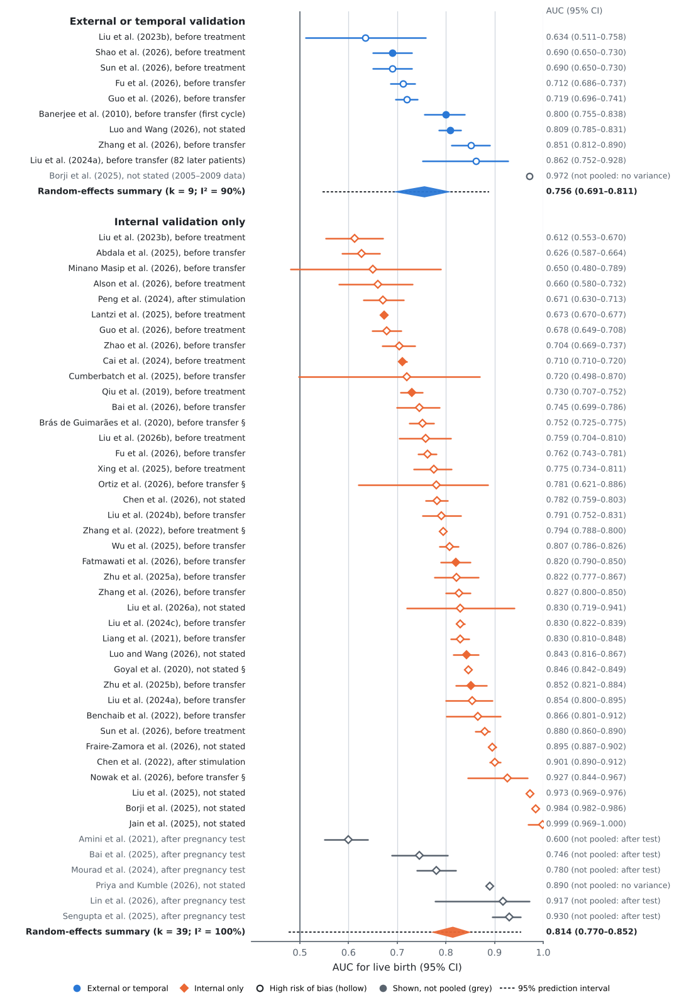
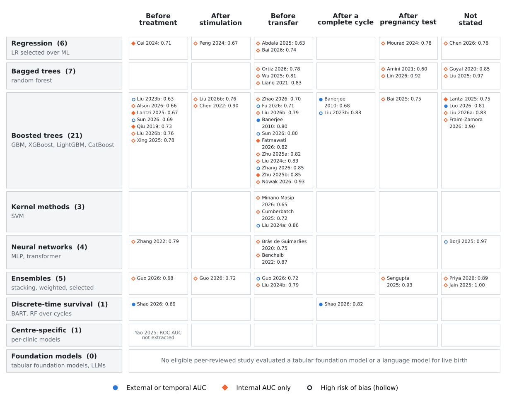

# Machine Learning for Live-Birth Prediction After IVF/ICSI

Data, code and a living list of studies for the systematic review and meta-analysis

> **Machine learning for live-birth prediction after IVF/ICSI from structured clinical data: a systematic review, meta-analysis and critical appraisal.**
> Abdul Raheem Shahzad, Juan Deng, Ming Zhang, Muhammad Zaheer Khan and Umar Ajaib. Manuscript under review, 2026.
>
> School of Computer Science, Wuhan University; Reproductive Medical Center, Zhongnan Hospital of Wuhan University; Clinical Medicine Research Center of Prenatal Diagnosis and Birth Health in Hubei Province, Wuhan, China.

Every number in the paper can be reproduced from this repository: the screening log, the extracted data, the risk-of-bias evidence, the two independent second appraisals, the study-level estimates and the analysis code.

## Contents

- [Key findings](#key-findings)
- [Included studies](#included-studies)
- [Reproducing the analysis](#reproducing-the-analysis)
- [Repository layout](#repository-layout)
- [Adding a new study](#adding-a-new-study)
- [Citation](#citation)

## Key findings

The review searched OpenAlex, Scopus and Web of Science to 22 October 2026 under PRISMA 2020. It identified 1,602 records, assessed 72 reports in full text and included **48 studies with 66 AUC estimates**. Discrimination was pooled on the logit scale with restricted maximum likelihood and Hartung–Knapp–Sidik–Jonkman intervals.

| Analysis | Pooled AUC (95% CI) | 95% prediction interval |
|---|---|---|
| Internal validation only (k = 39) | 0.814 (0.770–0.852) | 0.477–0.955 |
| Later period or another centre (k = 9) | 0.756 (0.691–0.811) | 0.546–0.889 |
| Not at high risk of bias (k = 8) | 0.764 (0.702–0.817) | 0.554–0.894 |
| At high risk of bias (k = 33) | 0.817 (0.764–0.860) | 0.450–0.960 |
| Decision point not stated (k = 9) | 0.910 (0.764–0.970) | 0.297–0.996 |

- **Validation design.** Internal and external estimates differ in the expected direction, but the difference is not significant (p = 0.11). Within the seven studies that reported both, the AUC changed by −0.041 (95% CI −0.134 to 0.033).
- **Unstated decision point.** This is the one robust marker of an inflated AUC in joint meta-regression: +1.12 on the logit scale (95% CI 0.56–1.69; permutation p = 0.001).
- **Machine learning vs logistic regression.** On the same data, the best machine-learning model beat logistic regression by a median of 0.028 AUC. The pooled gain was 0.056 (0.017–0.090), and 13 of the 16 comparisons were at high risk of bias.
- **Risk of bias.** PROBAST+AI rated 1 study at low risk, 7 at unclear and 40 at high risk. Ratings were checked by two independent AI-assisted second appraisals by co-authors (agreement statistics in `supplement/S7`).
- **Certainty.** GRADE rates the certainty of every pooled finding as low or very low (`supplement/S9`).



## Included studies

The table lists one estimate per study: the external estimate where one exists, otherwise the internal one. AUC "n.r." means no live-birth AUC could be extracted. All estimates are in [`supplement/S4_meta_analysis_estimates.csv`](supplement/S4_meta_analysis_estimates.csv), and this table is also in [`supplement/included_studies.csv`](supplement/included_studies.csv).

| # | Study | Journal | Setting | Family | Selected model | Decision point | Validation | AUC | RoB |
|---|---|---|---|---|---|---|---|---|---|
| 1 | [Banerjee 2010](https://doi.org/10.1073/pnas.1002296107) | PNAS | USA, 1 centre; 2003–2008 | Boosted trees | GBM boosted trees | Before transfer | External | 0.800 | Unclear |
| 2 | [Qiu 2019](https://doi.org/10.1186/s12967-019-2062-5) | Journal of Translational Medicine | China, 1 centre | Boosted trees | XGBoost | Before treatment | Internal | 0.730 | Unclear |
| 3 | [Brás de Guimarães 2020](https://doi.org/10.3390/reprodmed1030014) | Reproductive Medicine | Portugal, 1 centre; 2012–2019 | Neural networks | ANN | Before transfer | Internal | 0.752 | High |
| 4 | [Goyal 2020](https://doi.org/10.1038/s41598-020-76928-z) | Scientific Reports | UK, HFEA register | Bagged trees | RF | Not stated | Internal | 0.846 | High |
| 5 | [Amini 2021](https://doi.org/10.22074/ijfs.2020.134582) | International Journal of Fertility and Sterility | Iran, 1 centre; 2011–2014 | Bagged trees | RF | After pregnancy test | Internal | 0.600 | High |
| 6 | [Liang 2021](https://doi.org/10.1016/j.cmpb.2020.105780) | Computer Methods and Programs in Biomedicine | China, 1 centre; 2012–2015 | Bagged trees | Random forest, 100 trees, with genetic-algorithm search over modifiable factors | Before transfer | Internal | 0.830 | High |
| 7 | [Benchaib 2022](https://doi.org/10.1002/rmb2.12486) | Reproductive Medicine and Biology | France, 1 centre; 2013–2018 | Neural networks | MLP | Before transfer | Internal | 0.866 | High |
| 8 | [Chen Z 2022](https://doi.org/10.1097/CM9.0000000000001874) | Chinese Medical Journal | China, 1 centre; 2014–2018 | Boosted trees | XGBoost | After stimulation | Internal | 0.901 | High |
| 9 | [Zhang 2022](https://doi.org/10.3389/fendo.2022.838087) | Frontiers in Endocrinology | UK, HFEA register; 2005–2016 | Neural networks | ANN | Before treatment | Internal | 0.794 | High |
| 10 | [Liu X 2023](https://doi.org/10.1186/s12884-023-05775-3) | BMC Pregnancy and Childbirth | China, 1 centre; 2019–2021 | Boosted trees | LightGBM | Before treatment | External | 0.634 | High |
| 11 | [Cai 2024](https://doi.org/10.1093/humrep/dead242) | Human Reproduction | China, 1 centre; 2013–2020 | Regression | Lasso selected | Before treatment | Internal | 0.710 | Unclear |
| 12 | [Liu L 2024a](https://doi.org/10.1186/s12958-024-01253-3) | Reproductive Biology and Endocrinology | China, 1 centre | Kernel methods | SVM | Before transfer | External | 0.862 | High |
| 13 | [Liu L 2024b](https://doi.org/10.1186/s12958-024-01295-7) | Reproductive Biology and Endocrinology | China, 2 centres; 2016–2022 | Ensembles | Stacking | Before transfer | Internal | 0.791 | High |
| 14 | [Liu Z 2024](https://doi.org/10.1007/s10815-023-02997-4) | Journal of Assisted Reproduction and Genetics | China, 1 centre; 2013–2019 | Boosted trees | XGBoost with cycle features and day-3 morphology | Before transfer | Internal | 0.830 | High |
| 15 | [Mourad 2024](https://doi.org/10.1016/j.fertnstert.2023.11.035) | Fertility and Sterility | Canada, 2 centres; 2012–2016 | Regression | LR selected | After pregnancy test | Internal | 0.780 | High |
| 16 | [Peng 2024](https://doi.org/10.1038/s41598-024-83781-x) | Scientific Reports | China, 1 centre; 2015–2022 | Regression | LR selected | After stimulation | Internal | 0.671 | High |
| 17 | [Abdala 2025](https://doi.org/10.1007/s10815-025-03524-3) | Journal of Assisted Reproduction and Genetics | UAE, 1 centre; 2017–2023 | Regression | LR selected | Before transfer | Internal | 0.626 | High |
| 18 | [Bai 2025](https://doi.org/10.1186/s12884-025-07433-2) | BMC Pregnancy and Childbirth | China, 1 centre; 2016–2022 | Boosted trees | LightGBM | After pregnancy test | Internal | 0.746 | High |
| 19 | [Borji 2025](https://doi.org/10.1016/j.cmpb.2025.108979) | Computer Methods and Programs in Biomedicine | UK, HFEA register; 2010–2018 | Neural networks | PSO + TabTransformer | Not stated | External | 0.972 | High |
| 20 | [Cumberbatch 2025](https://doi.org/10.54808/JSCI.23.06.20) | Journal of Systemics, Cybernetics and Informatics | Barbados, 1 centre | Kernel methods | Linear SVM | Before transfer | Internal | 0.720 | High |
| 21 | [Jain 2025](https://doi.org/10.31449/inf.v46i7.8521) | Informatica | UK, HFEA register; 2010–2016 | Ensembles | Stacking with XGBoost meta-learner over RF, MLP, SVM | Not stated | Internal | 0.999 | High |
| 22 | [Lantzi 2025](https://doi.org/10.3390/biology14050556) | Biology | UK, HFEA register (source not named in the text); 2010–2018 | Boosted trees | DataRobot autopilot; XGBoost with early stopping and a Keras residual network chosen | Before treatment | Internal | 0.673 | Unclear |
| 23 | [Liu Y 2025](https://doi.org/10.3389/fendo.2025.1556681) | Frontiers in Endocrinology | China, 1 centre | Bagged trees | RF | Not stated | Internal | 0.973 | High |
| 24 | [Sengupta 2025](https://doi.org/10.18203/2394-6040.ijcmph20251387) | International Journal of Community Medicine and Public Health | India, 1 centre; 2018–2022 | Ensembles | Bayesian-optimised voting ensemble | After pregnancy test | Internal | 0.930 | High |
| 25 | [Wu 2025](https://doi.org/10.1186/s12967-025-07045-6) | Journal of Translational Medicine | China, 1 centre; 2016–2023 | Bagged trees | RF | Before transfer | Internal | 0.807 | High |
| 26 | [Xing 2025](https://doi.org/10.3760/cma.j.cn101441-20241213-00471) | Chinese Journal of Reproduction and Contraception (in Chinese) | China, 1 centre; 2017–2022 | Boosted trees | XGBoost | Before treatment | Internal | 0.775 | High |
| 27 | [Yao 2025](https://doi.org/10.1038/s41467-025-58744-z) | Nature Communications | USA, 6 centres | Centre-specific | Centre-specific ML | Before treatment | Internal | n.r. | High |
| 28 | [Zhu 2025a](https://doi.org/10.1186/s13048-025-01654-x) | Journal of Ovarian Research | China, 1 centre; 2019–2023 | Boosted trees | XGBoost | Before transfer | Internal | 0.822 | High |
| 29 | [Zhu 2025b](https://doi.org/10.1007/s10815-025-03677-1) | Journal of Assisted Reproduction and Genetics | China, 1 centre; 2018–2023 | Boosted trees | XGBoost | Before transfer | Internal | 0.852 | Unclear |
| 30 | [Alson 2026](https://doi.org/10.1038/s41598-025-31013-1) | Scientific Reports | Sweden, 1 centre; 2019–2022 | Boosted trees | XGBoost | Before treatment | Internal | 0.660 | High |
| 31 | [Bai J 2026](https://doi.org/10.3760/cma.j.cn101441-20251012-00398) | Chinese Journal of Reproduction and Contraception (in Chinese) | China, 1 centre; 2021–2024 | Regression | Logistic regression selected | Before transfer | Internal | 0.745 | High |
| 32 | [Chen 2026](https://doi.org/10.3389/fendo.2026.1967517) | Frontiers in Endocrinology | China, 1 centre; 2015–2023 | Regression | LR selected | Not stated | Internal | 0.782 | High |
| 33 | [Fatmawati 2026](https://doi.org/10.59345/sjog.v3i2.282) | Sriwijaya Journal of Obstetrics and Gynecology | Indonesia, 2 centres; 2018–2023 | Boosted trees | XGBoost | Before transfer | Internal | 0.820 | Unclear |
| 34 | [Fraire-Zamora 2026](https://doi.org/10.1007/s10815-026-03869-3) | Journal of Assisted Reproduction and Genetics | Spain, multicentre; 2011–2023 | Boosted trees | GBM | Not stated | Internal | 0.895 | High |
| 35 | [Fu 2026](https://doi.org/10.3389/fendo.2026.1949824) | Frontiers in Endocrinology | China, 1 centre; 2019–2024 | Boosted trees | GBM | Before transfer | External | 0.712 | High |
| 36 | [Guo 2026](https://doi.org/10.3389/fendo.2026.1916182) | Frontiers in Endocrinology | China, 2 centres | Ensembles | Ensembles of 10 base learners | Before transfer | External | 0.719 | High |
| 37 | [Lin 2026](https://doi.org/10.3389/fendo.2026.1898690) | Frontiers in Endocrinology | China, 1 centre; 2019–2025 | Bagged trees | RF | After pregnancy test | Internal | 0.917 | High |
| 38 | [Liu B 2026](https://doi.org/10.3389/fcell.2026.1742816) | Frontiers in Cell and Developmental Biology | China, 1 centre; 2020–2024 | Boosted trees | XGBoost | Not stated | Internal | 0.830 | High |
| 39 | [Liu L 2026](https://doi.org/10.3389/fendo.2026.1832301) | Frontiers in Endocrinology | China, 1 centre; 2019–2024 | Boosted trees | CatBoost | Before treatment | Internal | 0.759 | High |
| 40 | [Luo 2026](https://doi.org/10.1186/s12884-026-09610-3) | BMC Pregnancy and Childbirth | China, 1 centre; 2021–2024 | Boosted trees | XGBoost | Not stated | External | 0.809 | Unclear |
| 41 | [Minano Masip 2026](https://doi.org/10.3390/medicina62020364) | Medicina | Canada, 1 centre; 2012–2019 | Kernel methods | SVM on clinical data | Before transfer | Internal | 0.650 | High |
| 42 | [Nowak 2026](https://doi.org/10.5935/1518-0557.20260073) | JBRA Assisted Reproduction | Poland, 1 centre; 2013–2022 | Boosted trees | XGBoost | Before transfer | Internal | 0.927 | High |
| 43 | [Ortiz 2026](https://doi.org/10.1007/s10815-026-03928-9) | Journal of Assisted Reproduction and Genetics | Spain, multicentre; 2017–2023 | Bagged trees | RF | Before transfer | Internal | 0.781 | High |
| 44 | [Priya 2026](https://doi.org/10.22059/jitm.2026.107166) | Journal of Information Technology Management | UK, HFEA register; 2005–2016 | Ensembles | Ensemble of random forest and gradient boosting | Not stated | Internal | 0.890 | High |
| 45 | [Shao 2026](https://doi.org/10.1093/hropen/hoag085) | Human Reproduction Open | Belgium, 1 centre; 2014–2023 | Discrete-time survival | BART | Before treatment | External | 0.690 | Low |
| 46 | [Sun 2026](https://doi.org/10.2147/CLEP.S588848) | Clinical Epidemiology | China, 2 centres; 2017–2023 | Boosted trees | XGBoost | Before treatment | External | 0.690 | High |
| 47 | [Zhang A 2026](https://doi.org/10.1186/s13048-026-02251-2) | Journal of Ovarian Research | China, 1 centre; 2019–2023 | Boosted trees | GBM | Before transfer | External | 0.851 | High |
| 48 | [Zhao 2026](https://doi.org/10.3389/fendo.2026.1868575) | Frontiers in Endocrinology | China, 1 centre; 2021–2025 | Boosted trees | CatBoost | Before transfer | Internal | 0.704 | High |

Model families of the selected models: boosted trees 21, bagged trees 7, regression 6, ensembles 5, neural networks 4, kernel methods 3, centre-specific 1, discrete-time survival 1.



## Reproducing the analysis

```bash
pip install -r requirements.txt
python3 scripts/meta_analysis.py   # pooled analyses, meta-regression, sensitivity analyses (supplement/S10), Figs. 3-4
python3 scripts/certainty.py       # GRADE certainty table (supplement/S9)
python3 scripts/agreement.py       # inter-rater agreement and adjudication (supplement/S7, S8)
```

Results are written to `build/ma_results.json`, `build/figs/` and `supplement/`. The analysis uses only NumPy, SciPy and Matplotlib.

## Repository layout

| Path | Contents |
|---|---|
| `content/studies.json` | One row per AUC estimate: decision point, validation design, AUC, CI, evaluation-set size, events |
| `content/studies_meta.json` | One entry per study: setting, population, model, modelling steps, PROBAST+AI ratings |
| `content/rob_original.json`, `content/adjudication_log.csv` | Original risk-of-bias ratings and the reason for each change after adjudication |
| `supplement/S1_screening_log.csv` | All 819 screened records with source database, decision and retrieval status |
| `supplement/S2`–`S6` | Extraction sheet, risk-of-bias evidence, study-level estimates, re-checked secondary tabulation, PRISMA 2020 checklist |
| `supplement/S7`–`S10` | Inter-rater agreement, original/second-appraisal/final ratings, GRADE certainty of evidence, every pooled analysis |
| `supplement/second_appraisals/` | The complete files and logs of the two independent second appraisals |
| `search/search_strategy.md` | Exact query strings, dates and record counts |
| `scripts/` | Analysis code |
| `figures/` | Forest plot and taxonomy |

Full texts of the included studies are not redistributed. Each study is linked by its DOI.

## Adding a new study

The review is maintained as a living list. To suggest a study, open an issue using the "New study" template, giving the DOI, the decision point, the validation design and the reported live-birth AUC. Studies are added to the list after full-text assessment against the eligibility criteria in the paper. The pooled analyses are updated only in a new release.

## Citation

If you use this repository, please cite the paper and the repository (see [`CITATION.cff`](CITATION.cff)).

```bibtex
@misc{shahzad2026livebirthreview,
  author = {Shahzad, Abdul Raheem and Deng, Juan and Zhang, Ming and Khan, Muhammad Zaheer and Ajaib, Umar},
  title  = {Machine learning for live-birth prediction after {IVF/ICSI} from structured clinical data: a systematic review, meta-analysis and critical appraisal},
  year   = {2026},
  note   = {Manuscript under review. Data and code: https://github.com/abdul-raheem-shahzad/ml-ivf-live-birth-review}
}
```

## Licence

Code: MIT licence ([`LICENSE`](LICENSE)). Data and tables: CC BY 4.0 ([`LICENSE-DATA.md`](LICENSE-DATA.md)).

## Contact

Abdul Raheem Shahzad (corresponding author), abdul.raheem@whu.edu.cn
